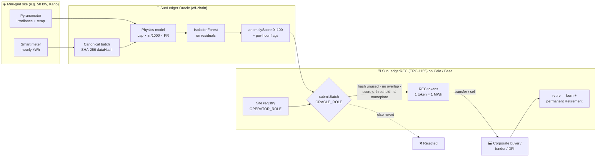

# ☀️ SunLedger

**Verifiable renewable energy certificates (RECs) for Nigerian solar mini-grids.**

AI-verified meter data → one on-chain certificate per MWh → sold to buyers → retired forever.

> IEEE ClimateChain Global Hackathon · Track: **Renewable Energy & Energy Trading**
> Built by **Lawal Ridwan**, frontend & web3 developer, Nigeria

---

## 1. The problem

Nigeria has 100+ solar mini-grid operators. Together they power communities, markets and clinics
that the national grid doesn't reach. They produce real clean energy, but they **can't easily prove it**:

| Pain | Why it matters |
| --- | --- |
| **Paper or spreadsheet RECs get double-counted** | The same MWh can be sold to two buyers, or claimed by a funder and a corporate at the same time. |
| **Meter data can be faked** | Inflated readings, generation logged at night, copied rows. Funders paying per kWh have no cheap way to check. |
| **Verification is slow and costly** | Manual audits don't work for a 50 kW site that makes about 1–2 MWh a month. Small operators get left out of carbon and REC markets. |
| **Buyers can't trust claims** | Corporates reporting Scope 2 emissions need proof that a certificate was retired once and can't be resold. |

The result: clean generation that is real but hard to sell, and funders who either over-pay for fake kWh
or under-fund honest operators.

## 2. The solution

SunLedger has three parts:

1. **AI meter verification** (`ai/anomaly.py`). Every hourly reading is checked against a physical
   model of what the panels *could* produce given the irradiance sensor
   (`capacity_kW × irradiance/1000 × performance ratio × temperature derate`). An **IsolationForest**
   (scikit-learn) runs on the residuals as well. Each batch gets an **anomalyScore (0–100)** and a
   **SHA-256 data hash**.
2. **On-chain certificates** (`contracts/SunLedgerREC.sol`, ERC-1155 + AccessControl).
   - 1 verified MWh = 1 token. Each site+period gets its own token id, with on-chain metadata:
     `siteId, periodStart, periodEnd, kWh, anomalyScore, dataHash`.
   - **A meter batch hash can only be minted once**, and a site's periods can never overlap. This blocks double counting.
   - **Batches with anomalyScore above the threshold are rejected** on-chain.
   - **Physical cap:** a batch can never claim more than `nameplate kW × hours`.
   - Sub-MWh remainders **carry forward** per site, so small sites still earn certificates over time.
   - `retire(id, amount, beneficiary, reason)` **burns** the certificates and writes a permanent
     `Retirement` record, so a claimed REC can't be resold.
3. **Oracle** (`ai/oracle.py`). Runs the detector and outputs the exact `submitBatch` payload as JSON.
   It can also broadcast the call with web3.py. In **quarantine** mode it drops the flagged hours and certifies only
   the clean energy. The operator still gets paid for real generation, and the fakes earn nothing.

### Architecture



### How it fits the Renewable Energy & Energy Trading track

- **Climate impact:** clean MWh from distributed solar becomes a tradeable, auditable asset.
  Operators get a second revenue stream on top of tariffs, which helps them expand and displace diesel generators.
- **Energy trading:** RECs are standard ERC-1155 tokens. They can be sold peer-to-peer, listed on any marketplace,
  or bundled for corporate buyers. Every token traces back to a site, a period and a hashed meter batch.
- **Trust without auditors on every site:** anyone can re-run the open-source detector against
  the raw data and check the dataHash, and the contract enforces the rules nobody should have to trust anyone on
  (no double minting, no over-capacity, no resale after retirement).

## 3. Demo results (sample data)

`ai/sample_data.csv` holds 168 hourly readings (5–11 Oct 2026, WAT) from a simulated **50 kW site in Kano**,
generated by `ai/generate_sample_data.py` with a solar-position model, day-to-day haze and cloud,
temperature derating and meter noise. **Six fake readings** were injected
(the ground truth is in `ai/injected_labels.json`, which the detector never reads):

| Injected fake | Detected as |
| --- | --- |
| 18.4 kWh at 02:00 | 🔴 critical: generation at night |
| 11.75 kWh at 23:00 | 🔴 critical: generation at night |
| 96.3 kWh in one hour (50 kW site) | 🔴 critical: exceeds nameplate + ML outlier |
| 71.2 kWh in one hour | 🔴 critical: exceeds nameplate + ML outlier |
| Cloudy hour inflated 17.4 → 37.1 kWh | 🟠 suspicious: IsolationForest + robust z on residual |
| Afternoon reading +17.5 kWh | 🟠 suspicious: IsolationForest + robust z on residual |

- **6/6 fakes caught, 0 false positives** on the 162 genuine hours.
- Tampered batch: **anomalyScore 100** → the contract reverts with `AnomalyTooHigh`.
- Same week with the fakes reverted to genuine readings: **anomalyScore 0**.
- Quarantine mode: 1,519 kWh claimed → **1,248 kWh verified** → **1 REC minted, 248 kWh carried forward**.

End-to-end run on a local Hardhat chain (`npm run demo`):

```
SunLedgerREC at 0x5FbD…0aa3 | site #1 registered (50 kW, Kano)
Tampered batch (score 100, 1519 kWh) -> REJECTED: AnomalyTooHigh
Verified batch (score 0, 1248 kWh) -> minted 1 REC, carry 248 kWh
Replay of same meter batch -> REJECTED: DuplicateBatch
Retired 1 REC for "Example Manufacturing Ltd (Kano)" (Q4 2026 Scope 2 claim); buyer balance now 0
```

## 4. Repository layout

```
sunledger/
├── contracts/SunLedgerREC.sol      ERC-1155 + AccessControl REC contract
├── test/SunLedgerREC.test.ts       21 Hardhat tests
├── scripts/deploy.ts               env-based deploy (Celo Sepolia / Base Sepolia / local)
├── scripts/demo.ts                 end-to-end: oracle payload → reject/mint → transfer → retire
├── hardhat.config.ts
├── ai/
│   ├── anomaly.py                  physics model + IsolationForest → anomalyScore + dataHash
│   ├── oracle.py                   builds submitBatch payload (JSON); optional web3.py send
│   ├── generate_sample_data.py     reproducible synthetic 50 kW Kano dataset (seeded)
│   ├── sample_data.csv             168 hourly rows with 6 injected fakes
│   ├── injected_labels.json        ground truth for evaluation
│   ├── test_anomaly.py             7 Python tests
│   └── requirements.txt
├── .env.example                    no keys are committed
└── LICENSE                         MIT
```

## 5. Setup & run

**Requirements:** Node.js 18+ (tested on 22), Python 3.10+ (tested on 3.12).

```bash
# Smart contracts
npm install
npx hardhat compile
npx hardhat test                 # 21 passing

# AI detector + oracle
python3 -m venv .venv && source .venv/bin/activate
pip install -r ai/requirements.txt
python3 ai/generate_sample_data.py          # optional: regenerate the dataset (seeded)
python3 ai/anomaly.py ai/sample_data.csv --capacity-kw 50
python3 ai/anomaly.py --json                 # machine-readable report
python3 -m unittest ai/test_anomaly.py -v    # 7 passing

# Oracle payloads
python3 ai/oracle.py                         # strict: raw batch (will be rejected)
python3 ai/oracle.py --mode quarantine       # fake hours excluded, clean energy certified

# Full end-to-end demo on a local chain
npm run demo
```

### Deploy to a testnet

```bash
cp .env.example .env     # fill DEPLOYER_PRIVATE_KEY, OPERATOR_ADDRESS, ORACLE_ADDRESS
npm run deploy:celoSepolia     # Celo Sepolia, chainId 11142220
npm run deploy:baseSepolia     # Base Sepolia, chainId 84532
```

> **Note on Celo Alfajores:** Celo retired Alfajores on 30 Sep 2025 and replaced it with **Celo Sepolia**
> ([Celo docs](https://docs.celo.org/build-on-celo/network-overview)). The `alfajores` network entry is still there for old tooling,
> but deploy to `celoSepolia`.

Then send a verified batch from the oracle wallet:

```bash
pip install web3
export SUNLEDGER_RPC_URL=https://forno.celo-sepolia.celo-testnet.org
export SUNLEDGER_CONTRACT=0x...   ORACLE_PRIVATE_KEY=...
python3 ai/oracle.py --mode quarantine --send   # preflight refuses to send a batch the contract would reject
```

## 6. Contract reference

| Function | Role | Purpose |
| --- | --- | --- |
| `registerSite(name, location, capacityKw, payout)` | OPERATOR | Register a mini-grid; certificates go to `payout` |
| `setSiteActive(siteId, bool)` | site operator / admin | Pause a site (e.g. meter replaced) |
| `submitBatch(siteId, periodStart, periodEnd, kWh, anomalyScore, dataHash)` | ORACLE | Verify and mint `floor((kWh + carry)/1000)` RECs |
| `retire(id, amount, beneficiary, reason)` | any holder | Burn RECs and store a permanent `Retirement` |
| `setAnomalyThreshold(uint8)` | ADMIN | Default 30 (0–100) |
| `getSite`, `getCertificate`, `getRetirement`, `certificateId`, `batchHashUsed`, `totalRetired` | view | Audit trail |

**Checks in `submitBatch`:** site exists and is active · hash never used · `periodStart < periodEnd ≤ now` ·
no overlap with the site's last period · `kWh > 0` · `score ≤ threshold` · `kWh ≤ capacity × hours`.
A rejected batch does **not** burn its hash, so a corrected batch can still be submitted.

**Anomaly score** (in `ai/anomaly.py`):
`min(100, 400 × unexplained-excess-energy share + 20 × critical hours + 8 × suspicious hours)`.
A critical hour is physically impossible (night generation, over nameplate, negative). A suspicious hour is one where the
IsolationForest marks it as an outlier **and** its residual is above ±25% / 3 kWh **and** its robust z-score is above 3.5.
The weights are tuned for this hackathon. Production weights would be calibrated on labelled field data.

## 7. Roadmap

- **v0.1 (this hackathon):** contract, tests, AI detector, oracle, local end-to-end demo, testnet deploy scripts.
- **v0.2:** operator dashboard (React + wagmi) with site map, monthly kWh, flagged hours and RECs held. Buyer portal with retirement certificate PDFs.
- **v0.3:** signed meter data at the edge (device keys on the meter or gateway), so the oracle verifies a signature
  as well as statistics. Satellite irradiance cross-check (e.g. NASA POWER) in case the site's pyranometer is tampered.
- **v0.4:** multi-oracle quorum (k-of-n oracles must agree on hash and score). Slashing or role revocation for bad oracles.
- **v1.0:** alignment with an established REC standard (e.g. I-REC) through a registered issuer, so tokens can mirror or bridge recognised certificates.
  Mainnet on Celo, which suits low fees and mobile-first wallets in Africa.

## 8. Scaling & adoption plan

| Stakeholder | What they get | How we reach them |
| --- | --- | --- |
| **Mini-grid developers** | A new revenue stream from RECs, and automated proof of performance for investors | Pilot with 2–3 operators in Northern Nigeria (Kano/Kaduna). Most sites already have smart meters and remote monitoring, so integration is one CSV/API export per site. |
| **REA Nigeria and programme funders** (Rural Electrification Agency; World Bank/AfDB-backed mini-grid programmes) | Results-based grants paid per *verified* kWh, with a public audit trail and less manual verification | Offer SunLedger as a verification layer for per-connection or per-kWh grant disbursement. Read-only dashboard for programme officers. |
| **Corporate buyers** (manufacturers, telcos, banks with ESG reporting) | Local RECs with provenance down to the site and hour, and retirement records they can show auditors | Bundle certificates from many small sites into buyer-sized lots. Retirement through a simple web checkout, with the on-chain record linked in ESG reports. |
| **Climate finance / DFIs** | Portfolio-level clean MWh data that can't be double-counted | Same data feed. Extend to carbon-credit methodologies for diesel displacement. |

**Scaling path:** 1 site → a pilot operator's portfolio → many operators across Nigeria → other ECOWAS markets.
On-chain cost per site per period is a single `submitBatch` transaction, so it grows linearly and stays cheap on L2s.
The detector is lightweight (it runs in seconds on a laptop), so one oracle can serve thousands of sites.

## 9. Limitations (honest notes)

- The sample dataset is **synthetic** (seeded and reproducible), not field data from a real operator.
- The oracle is a single trusted role in v0.1. The roadmap adds signed meters and a multi-oracle quorum.
- The contract hasn't been audited. Don't use it with real value before an audit.

## License

MIT © 2026 Lawal Ridwan. See [LICENSE](LICENSE).
